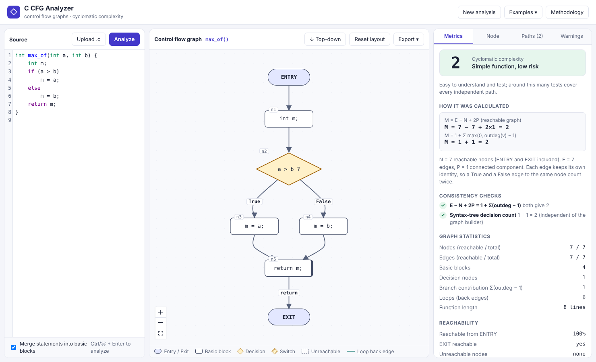

# C CFG Analyzer

Automated generation and visualization of **control flow graphs** and **cyclomatic complexity** from C source code.
Paste or upload a C function → get a directed CFG, the complexity with its working shown, reachability, independent
test paths, and warnings. The code is **parsed, never compiled or executed**.



* **Backend:** Python 3.10+, Flask, tree-sitter (C grammar). Pipeline: parse → CFG → basic blocks → reachability → complexity → basis paths → JSON.
* **Frontend:** React 18, TypeScript, Vite, React Flow + dagre (layout only), CodeMirror 6.
* **One source of truth:** the JSON from `POST /api/analyze`. The UI never recalculates a metric.

## Run it on macOS

Prerequisites: Python 3.10+ and Node.js 18+ (`brew install python node` if needed). Open Terminal in this folder.

**Quickest (one process, port 5000):**

```bash
./scripts/start.sh          # creates .venv, installs everything, builds the UI, starts the server
# open http://127.0.0.1:5000
```

**Or step by step:**

```bash
python3 -m venv .venv
source .venv/bin/activate
pip install -r backend/requirements.txt
(cd frontend && npm install && npm run build)
cd backend && python -m cfg_analyzer          # http://127.0.0.1:5000
```

**Development mode (hot reload):** terminal 1 `cd backend && python -m cfg_analyzer`, terminal 2 `cd frontend && npm run dev` → http://localhost:5173 (Vite proxies `/api` to port 5000).

**Tests:**

```bash
pip install -r backend/requirements-dev.txt && python -m playwright install chromium   # once
python -m pytest tests --ignore=tests/e2e        # backend (553 tests)
(cd frontend && npm run typecheck && npm test)   # frontend unit tests (28)
(cd frontend && npm run build) && python -m pytest tests/e2e   # real-browser tests (20, needs the build)
```
`make setup`, `make run`, `make dev`, `make test` wrap the same commands.

## Using it

1. Type or paste C code, press **Analyze** (or Ctrl/⌘ + Enter), choose an example from **Examples**, or **Upload .c**.
2. With several functions, pick one in the **Function** menu (`main` is the default).
3. Click a node → its source lines highlight in the editor and the **Node** tab shows its role, statements, incoming and outgoing edges. Click a source line → the matching node(s) are selected.
4. **Metrics** shows M, the formula with real numbers, consistency checks and reachability. **Paths** lists the M independent paths; click one to highlight it. **Warnings** lists unreachable code, unsupported-but-ignored directives, etc.
5. Zoom/pan/fit with the controls, toggle top-down / left-right, **Reset layout**, drag nodes freely (metrics never change). **Export** gives SVG, PNG, JSON, and a Markdown summary.

Invalid or unsupported C is never drawn: you get the error with line/column and the editor line is marked.

## Repository layout

```
backend/cfg_analyzer/   parser, validation, cfg_builder, basic_blocks, reachability, complexity,
                        structural, basis_paths, serialize, analyzer, api
frontend/src/           App, api, layout, exportGraph, sourceMap, components/, __tests__/
tests/                  pytest suite (+ tests/e2e Playwright)
examples/               16 C programs + manifest.json with hand-derived expected N, E, M
docs/                   ARCHITECTURE, ALGORITHMS, API, SUPPORTED_C, REFERENCE_ANALYSIS, TEST_RESULTS, screenshots
```

## Complexity in one paragraph

`M = E − N + 2P` on the part of the CFG reachable from ENTRY (dead code is shown but excluded), cross-checked with
`M = P_d + 1`. The default **course convention** counts every `default` label as a predicate; the Metrics panel
toggle selects plain **strict McCabe**, where defaults do not count. In course mode, default-bearing switches are
drawn as binary label tests. Any formula disagreement is reported in the analysis and warnings. Full details:
[docs/ALGORITHMS.md](docs/ALGORITHMS.md).

## Documentation

[Architecture](docs/ARCHITECTURE.md) · [Algorithms](docs/ALGORITHMS.md) · [API](docs/API.md) ·
[Supported C and limitations](docs/SUPPORTED_C.md) · [What was taken from the references](docs/REFERENCE_ANALYSIS.md) ·
[Test results](docs/TEST_RESULTS.md)

## Known limitations (short list)

Macros are not expanded and `#if` inside a function is rejected; analysis is intra-procedural; only literal-true loop
conditions are folded; independent paths are structural (feasibility is not checked); developed and tested on Linux with
Chromium only — see [TEST_RESULTS.md](docs/TEST_RESULTS.md) for what was and was not verified.
