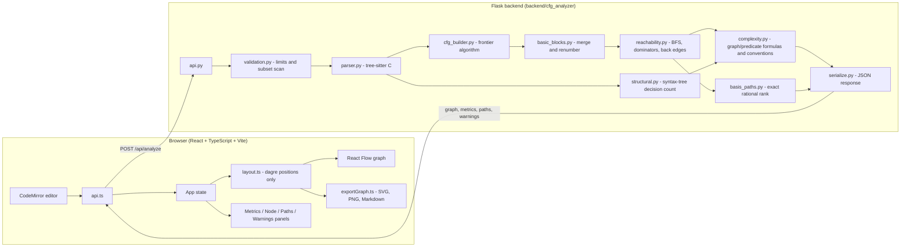

# Architecture

One React frontend, one Flask backend, one JSON API, **one graph model**. The backend decides which
transitions exist and what the metrics are; the frontend only decides *where* things are drawn.

## Backend modules (`backend/cfg_analyzer/`)

| Module | Responsibility |
|---|---|
| `api.py` | HTTP only: JSON parsing, structured error handlers, `/api/analyze`, `/api/examples`, optional static UI. No analysis logic. |
| `validation.py` | Request validation and limits; scan of the function for constructs outside the supported subset (blocking errors vs warnings). |
| `parser.py` | tree-sitter wrapper: parse, find functions, collect syntax errors (with line/column), shared expression helpers. |
| `cfg_builder.py` | Syntax tree → fine-grained CFG (one node per statement or predicate). Short-circuit/ternary expansion, loops, switch, jumps. |
| `basic_blocks.py` | Textbook merging of straight-line nodes into blocks; deterministic renumbering. |
| `reachability.py` | Reachability and shortest distance from ENTRY, nodes that cannot reach EXIT, dominators, loop back edges. |
| `complexity.py` | Cyclomatic complexity and its cross-checks; interpretation band; applicability notes. |
| `structural.py` | Independent decision count from the syntax tree (never looks at the CFG). |
| `basis_paths.py` | Independent ENTRY→EXIT basis paths, verified by exact rank. |
| `serialize.py` | Builds the response. The single source of truth for the UI. |
| `analyzer.py` | The pipeline (no HTTP). |
| `model.py`, `errors.py` | Graph dataclasses; structured exceptions with codes, status and locations. |

## Frontend (`frontend/src/`)

| File | Responsibility |
|---|---|
| `App.tsx` | State: source, result, error, selection, highlighted path. Wires editor ↔ graph ↔ panels. |
| `api.ts`, `types.ts` | Typed API client; `types.ts` mirrors the JSON response. |
| `layout.ts` | dagre layout (positions only), diamond edge clipping, loop back-edge routing. |
| `components/CfgGraph.tsx`, `CfgNodeView.tsx`, `CfgEdgeView.tsx` | React Flow rendering. Nodes are draggable; moving them changes nothing but pixels. |
| `components/CodeEditor.tsx` | CodeMirror 6: line highlights, error lines, unreachable lines, click/selection → graph. |
| `components/*Panel.tsx`, `NodeDetails.tsx` | Display backend values only; nothing is recalculated. |
| `exportGraph.ts` | SVG generated from the same graph + layout (not a DOM screenshot), PNG via canvas, Markdown summary. |
| `sourceMap.ts` | Line ↔ node lookups and shortest-path reconstruction from backend parent edges. |

## Data flow for one analysis

1. The user presses **Analyze** → `POST /api/analyze {source, function?, convention?, options}` (`course` is the API default).
2. `validate_request` checks shape and limits; the source is parsed with tree-sitter (a fresh parser per call).
3. Syntax errors inside the selected function stop the analysis with line/column locations (HTTP 422). The same happens for unsupported constructs. No partial graph is ever returned.
4. `build_cfg` creates the fine-grained graph; `compact` merges basic blocks; `renumber` makes ids deterministic.
5. `reachability` marks reachable/unreachable nodes and back edges; `complexity` computes M; `basis_paths` extracts the basis.
6. `serialize` returns nodes, edges, source map, statistics, complexity, reachability, paths, warnings.
7. The frontend lays the graph out, renders it, and links nodes ↔ source lines with the returned `source_map`.

## Design decisions

* **No competing implementations.** The references each contained a parser, CFG builder, metrics code and renderer; the final project has exactly one of each.
* **Complexity is computed once, in Python.** The React app shows the selected convention's `complexity.value` and both backend substitutions; it never recalculates metrics.
* **Fine-grained first, blocks second.** Merging is a separate, testable pass, and a property test checks that it never changes M.
* **Dead code is kept, not dropped.** It is drawn dashed and excluded from M, so it cannot be mistaken for an execution path.
* **Stable identities.** Node ids `n<i>` (ENTRY = 0, source order, EXIT last) and edge ids `e<i>` are deterministic for a given source. Parallel edges keep separate ids.
* **No database, accounts or code execution.**
